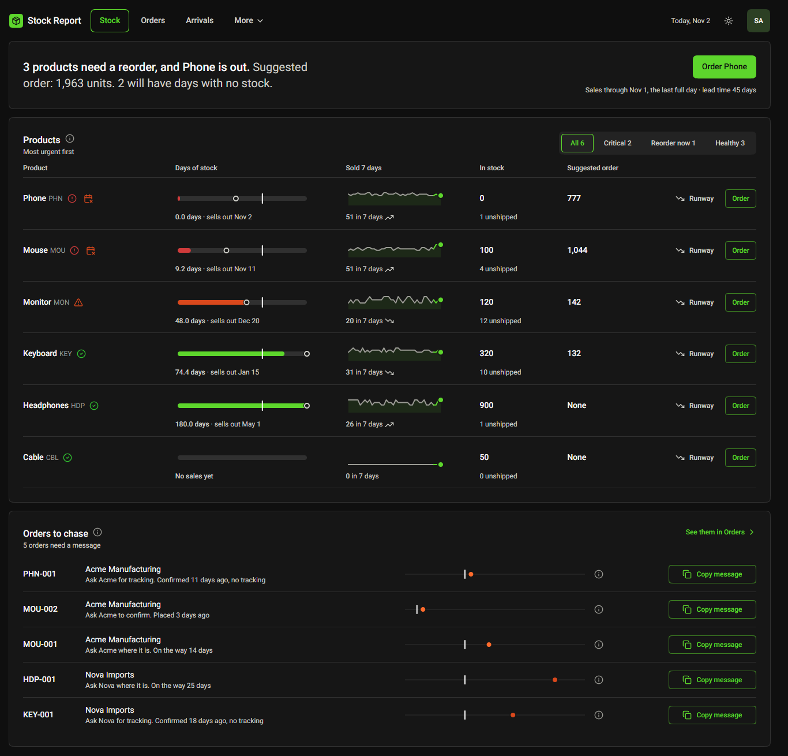
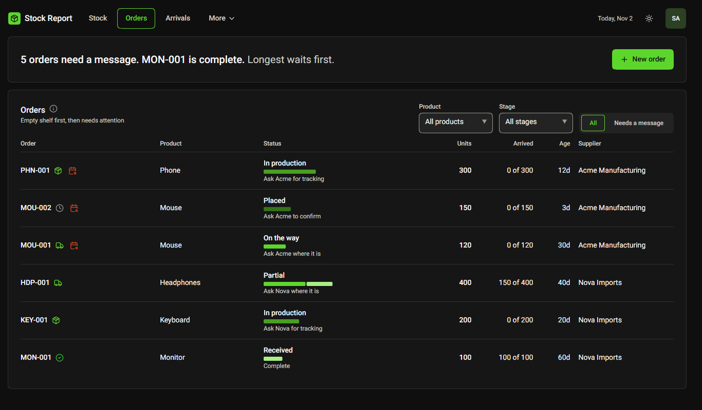
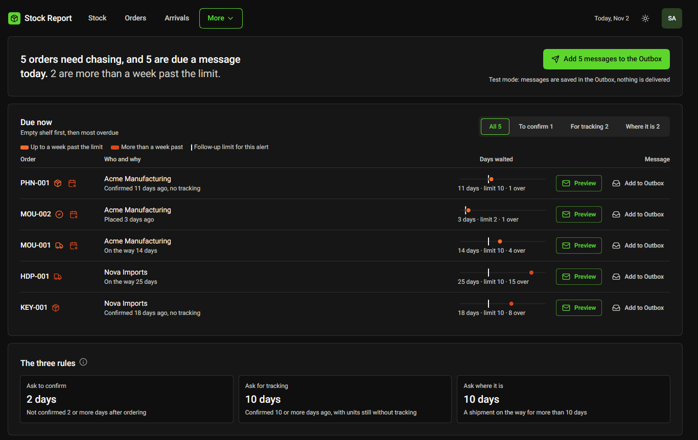
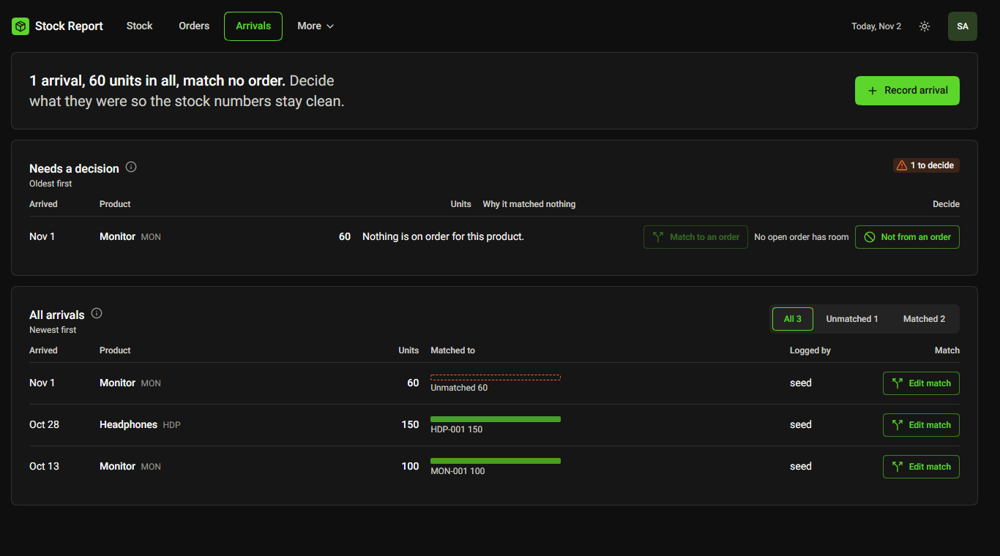
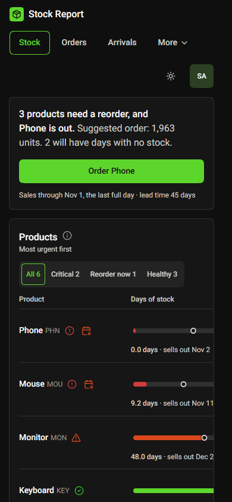
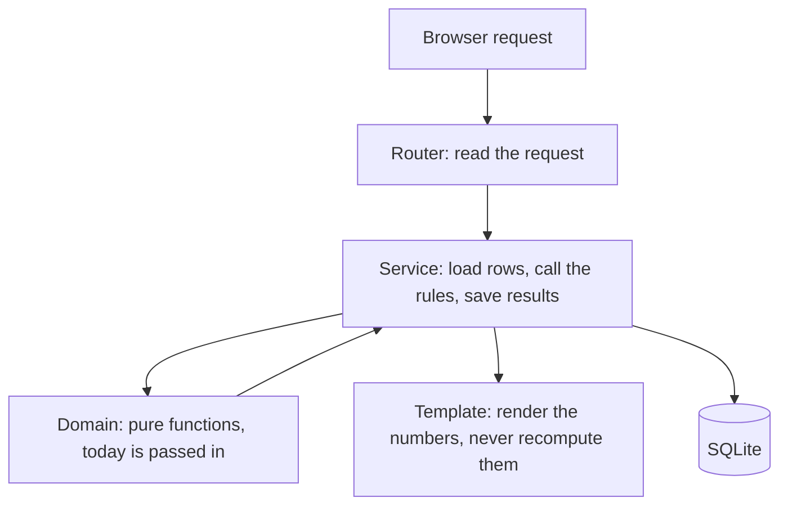

<h1 align="center">Stock Report</h1>

<p align="center">
  A stock, supplier-order and warehouse-arrival tracker for a small product business, with a weekly reorder view.
</p>

<p align="center">
  
  
  
  
  
</p>

<p align="center">
  
</p>

## Contents

- [Overview](#overview)
- [Key features](#key-features)
- [Screens](#screens)
- [How it works](#how-it-works)
- [Project structure](#project-structure)
- [Run it](#run-it)
- [Settings](#settings)
- [Design decisions](#design-decisions)
- [Problems found and fixed](#problems-found-and-fixed)
- [Known limits](#known-limits)
- [Future work](#future-work)

## Overview

Shows a small product business how much stock it has, how fast each product sells, when to reorder, and where every supplier order is. Built as a 4-day assignment. All data is fake.

- **Staff** see everything in their company: products, forecast, orders, arrivals, the chase list and settings.
- **Suppliers** see only the orders addressed to their email. They can confirm an order and add tracking, and nothing else.
- Every Stock page number comes from one set of pure rule functions, so a number is the same on every screen.
- Built with FastAPI, Jinja2, HTMX and SQLite. No front-end build step. Written with AI-assisted coding.
- **Stock gap** (the one extra feature): says whether a product will have empty shelves that ordering today can no longer prevent.

## Key features

| Area | What it does |
| --- | --- |
| Products and stock | A product list with name, short code and the identifiers that match sales to a product. Each product holds warehouse stock, units sold but not shipped, and units sold per day. Bundles count correctly ("Buy 2 Get 2" sells 4 units). |
| Forecast | Per product: sold in 7 days, daily sales rate, trend, days of stock, days of stock with everything ordered, sells-out date, reorder-by date and suggested order. |
| Flags | Out of stock, reorder now (even counting what is already ordered) and running low (urgent under 21 days, watch under 45). |
| Try an order | Type a number of units and see the new days of stock at once. Nothing is saved. |
| Supplier orders | Each order gets a readable name (`PHN-001`) and moves through placed, in production, on the way and arrived, with partial arrivals. Add several tracking numbers, each with its unit count, that never add up to more than the order. Edit, cancel, close, reopen and delete (with a confirmation). Filter by product and stage. Tracking numbers link to UPS, FedEx, USPS and DHL. |
| Order history | Every action on an order is logged: who did what, and when. |
| Order messages | Prepare the order message and follow-up messages, then copy them or open them in an email app. |
| Warehouse arrivals | Record an arrival. It is matched to open orders automatically, oldest first, spilling over into the next. Fix a match by hand, split it across orders, or mark units "not from an order". Arrivals that match no order stay on a list until someone decides. |
| Stock history | Log a manual sale or adjustment with a note. Each product shows every movement: arrivals, moves between orders and manual changes, with what, when and why. |
| Chase list | Shows which orders need a message: ask to confirm (2 days), ask for tracking (10 days after confirming) and ask where it is (more than 10 days on the way). An alert repeats at most every 2 days. |
| Settings | Edit products, suppliers and the forecast settings (lead time, safety days, target days), as defaults and per product. Turn reorder alert emails on or off, choose who gets them and send a test. |
| Old-data warning | A banner appears when the stock or sales data is more than 2 days old. |
| Access | Staff see and manage everything in their company. A supplier login sees only that supplier's orders and can only confirm them and add tracking. |
| Extras | Sign up with separate companies, a sales CSV import, the stock gap, dark and light themes, and a layout that works at 390 px wide. |

## Screens

| Orders | Chase list |
| --- | --- |
|  |  |

| Arrivals | Phone (390 px) |
| --- | --- |
|  |  |

**One symbol language.** A small icon beside a name shows a status. Hovering it, tabbing to it or tapping it on a phone opens a card with the label and detail. The stock gap is the orange calendar symbol: "Empty N days" and the first order that ends the gap.

**Keys and notes live in an "i" icon.** Each panel keeps its explaining text and chart key in a round "i" beside the title, drawn with the same marks as the chart: the stage bar colours on Orders, the match bar on Arrivals, and the bar, reorder line and ring on Stock. The rows stay quiet and the key is one hover away.

**On a phone.** The page never scrolls sideways. A wide table scrolls inside its own card, the main action fills the card width, filters stack under the title, and every tap target is 44 px.

## How it works

A request goes through three layers, and only the first one holds business rules.



| Layer | Folder | Does |
| --- | --- | --- |
| Domain | `app/domain/` | The business rules as pure functions: forecast, orders, matching, chase, runway, messages. No database, no clock. |
| Services | `app/services/` | Load rows, call the rules, save results. |
| Routers | `app/routers/` | Thin. Read the request, call a service, render a template. |
| Templates | `app/templates/` | Pages and dialogs. A native `<dialog>` is opened by an HTMX swap into `#modal-host`. |

**Forecast rules.** Sold in the last 7 days sets the daily burn. A trend factor (last 3 days against the 4 before, clamped between 0.5 and 2) gives the adjusted burn. Days of stock is stock divided by the adjusted burn, and the reorder line is lead time plus safety days (45 plus 14 by default).

**The three chase rules.** Ask to confirm after 2 days. Ask for tracking 10 days after confirming. Ask where it is once an order has been on the way more than 10 days. A chased order waits 2 days before it can be chased again.

**Companies and access.** Every company's rows are filtered in one place: a database hook adds the company filter to every SELECT, including lazy loads, so no route can forget it. A supplier session sees only orders whose supplier email matches the login. Another company's row is a 404, not a 403.

## Project structure

```
StockReport/
├── app/
│   ├── domain/        # the business rules as pure functions
│   ├── services/      # load rows, call the rules, save results
│   ├── routers/       # thin request handlers
│   ├── templates/     # pages and dialogs
│   ├── static/        # app.css, app.js, self-hosted Roboto
│   ├── charts.py      # inline SVG charts, colored by CSS classes
│   ├── tenancy.py     # company scope and the supplier scope
│   └── reset.py       # python -m app.reset: a clean Company 1
├── design/            # the design pages the screens were built from
├── tests/             # rule tests, page tests, style tests
├── scripts/           # demo.ps1 and demo.sh
└── assets/            # screenshots used in this README
```

## Run it

You need Python 3.12 or newer.

```powershell
python -m venv .venv
.venv\Scripts\pip install -r requirements-dev.txt
.venv\Scripts\python -m pytest -q          # optional: the tests
scripts\demo.ps1                           # starts the app on a throwaway database
```

On macOS or Linux use `.venv/bin/pip` and `scripts/demo.sh`.

Open the `localhost` address the terminal prints. The demo script gives three demo accounts the placeholder password `P@ss123`, which is for demo data only (use `scripts\demo.ps1 -Password 'other'` to change it):

| Account | Role | Sees |
| --- | --- | --- |
| `sam@example.com` | staff | everything |
| `acme@acme.example.com` | supplier | only Acme Manufacturing's orders; can confirm and add tracking |
| `nova@nova.example.com` | supplier | only Nova Imports' orders; can confirm and add tracking |

**On a phone.** Run `scripts\demo.ps1 -Lan` (or `LAN=1 scripts/demo.sh`) and use the network address it prints. The server only listens on this computer unless you ask for that, and on Windows you may need to allow Python through the firewall.

**Your own data.** `scripts/demo.ps1` uses a fresh database every time, so you can click anything and start over. To run on your own `stock.db` instead:

```powershell
.venv\Scripts\python -u -m uvicorn app.main:app --port 8000
```

The first start creates the accounts and prints a random password once (set `DEMO_PASSWORD` first to choose one). Do not use `--reload` on Windows: it leaves stray server processes behind. To start over on `stock.db`, stop the server and run `.venv\Scripts\python -m app.reset`. It keeps a copy as `stock.db.bak`.

**Sign up.** Create your own account at `/signup`.

- **Buy stock** makes a new company with its own products, orders and suppliers, separate from the demo's Company 1. The empty Stock page has a "Load sample data" button.
- **Supply stock** makes a supplier login. It sees the orders buyers address to its email, so add the supplier in Settings with the same email.
- There is no email check (demo only) and passwords need 6 or more characters.

**Sales import.** Open Settings, then Sales import, and upload a CSV with three columns (`date,item,units`). Each item must be one of a product's sales identifiers (Settings, Products) or a bundle title. **Check file** shows what would change and saves nothing. **Import** saves it. A day in the file replaces the saved number for that product and day, so importing the same file twice changes nothing, and warehouse stock is never touched. The page has an example file.

## Settings

| Variable | Default | What it does |
| --- | --- | --- |
| `DATABASE_URL` | `sqlite:///stock.db` | Which database to use. Tests and the demo script use a throwaway one. |
| `DEMO_PASSWORD` | random, printed once | Password given to the demo accounts when they are created. |
| `SECRET_KEY` | random per start | Signs the session cookie. Set it to keep people signed in across restarts. |
| `SENDER_NAME` | `Sam` | Name that signs follow-up messages. |

No secret is stored in the repository.

## Design decisions

| Decision | Why | Cost |
| --- | --- | --- |
| Business rules only in `app/domain/`, as pure functions | A number can be tested without a database or a clock, and no screen can drift from another. | Services must pass `today` and every input in by hand. |
| FastAPI, Jinja2, HTMX and SQLite | Small team, no build step, one file for the database. Dialogs and live filters need no front-end framework. | HTMX ignores 4xx replies, so a dialog must answer 200 with its own explanation. |
| Company filter in one database hook | A route cannot forget it. Staff, supplier and signed-out sessions each get their own scope. | Any code that opens its own session must set the scope too. |
| Another company's row is a 404, not a 403 | A 403 would confirm the row exists. | Harder to debug as a user. |
| Supplier access by matching email | A supplier must see only their own orders, and an email is the natural key. | No email check, so anyone who guesses a supplier's address could sign up as it. Known demo limit. |
| Expected arrival is order date plus lead time | Orders have no expected-date field. | It is an estimate, and the screens say so. |
| Stock gap uses the product's lead time as its window | Only empty days before a new order placed today could land are days ordering cannot prevent. | A Healthy product never shows a gap, even if it will run out much later. |
| Stock gap is staff only | A supplier session cannot see other suppliers' orders, and showing it would leak stock levels. | Suppliers cannot see how urgent an order is. |
| Email is test mode only | The app calls no outside service. Messages go to the Outbox. "Send by email" opens a Gmail compose tab and the user presses Send. | Nothing is delivered by the app. |
| Flat tonal look, no shadows, gradients or blur | Calm and dense, one green accent. A test enforces it. | No depth cues. Surfaces are separated by tone and a 1 px line. |
| Icon plus a hover card instead of pills on lists | Rows stay quiet. The label and detail open on hover, keyboard focus or tap. | Status needs one more step to read. Each symbol also has an `aria-label`. |
| Products can be edited and added, not deleted | They carry history. | Mistaken products stay in the list. |

## Problems found and fixed

Each one was caught by a test, a screenshot or a check against the business rules. Most have a test now.

| What went wrong | What I learned |
| --- | --- |
| The Chase badge in the top bar showed other companies' counts | Code that opens its own database session has no scope and sees everything. It must set the scope itself. |
| The stock gap first counted 90 days and flagged Healthy products | The window is the product's lead time, which is what "Healthy" means in the rules. I checked the numbers against the written rules and corrected it. |
| A Phone badge said "Empty 49 days" next to an order landing in 33 days | It counted a second empty stretch. Reworded, then the window was changed. |
| Two components used the CSS class `.step` and clipped the timeline icons | Check for a name clash before adding a class. |
| Stage bars ignored their width and overflowed on large orders | The bar width must come from the units, not a fixed size. |
| Sign up showed "Internal Server Error" after a code change | An old server keeps the old Python but reads new templates from disk. Restart after every change. |
| The route-crawl test found 0 routes after a FastAPI upgrade | A test that checks nothing still passes. The crawl now unwraps nested routers. |
| `pip-audit` found 14 known problems in the first package versions | Upgraded in two tested steps. It now reports no known vulnerabilities. |

## Known limits

- Email is test mode only: messages are saved in the Outbox and nothing is delivered. A saved follow-up can be deleted from the Outbox, which clears its 2-day wait so the order goes back on the Chase list.
- Expected arrival is order date plus lead time. Orders have no expected-date field, so this is an assumption.
- The suggested order size ignores units already on order, so it can be too large. The order dialog says so.
- The warehouse count is the last count plus what is recorded in the app. Imported daily sales set the burn and do not change the count.
- Sign-in throttling and sessions are simple and live in memory. Good for a demo, not for production.
- No email check at sign up, so a supplier address can be claimed by anyone who knows it.
- Not tested in a real browser on a real phone: the Gmail compose link needs a Gmail sign-in, and the squircle corners show only in Chrome and Edge 139+.

## Future work

- Part 2 of the stock gap: a staff-set rush flag on an order that the supplier can see.
- Email confirmation or an invite link for suppliers.
- Real email delivery behind the Outbox.
- Replace sessions and throttling kept in memory with a shared store.
- A deployment.
